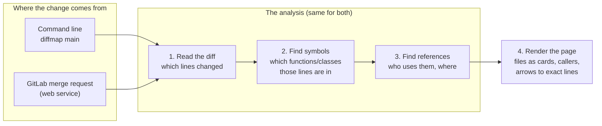
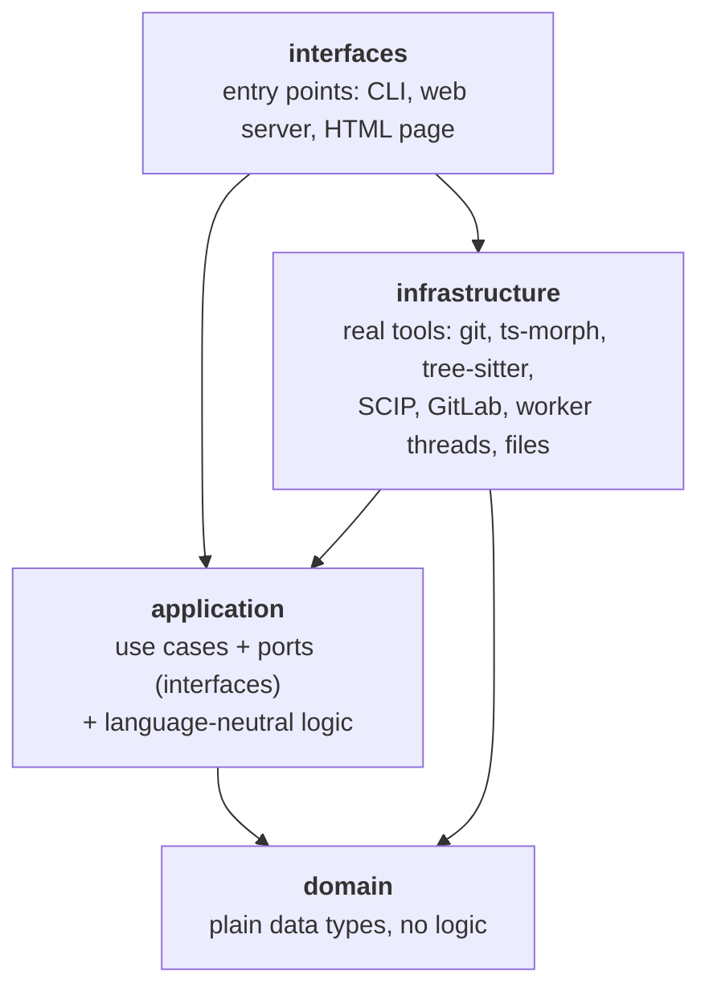
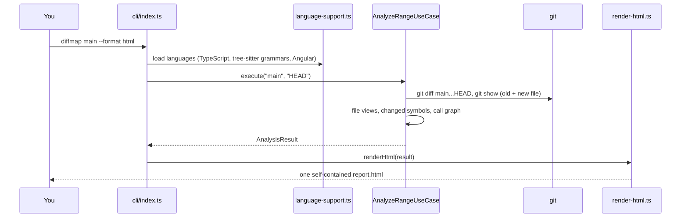
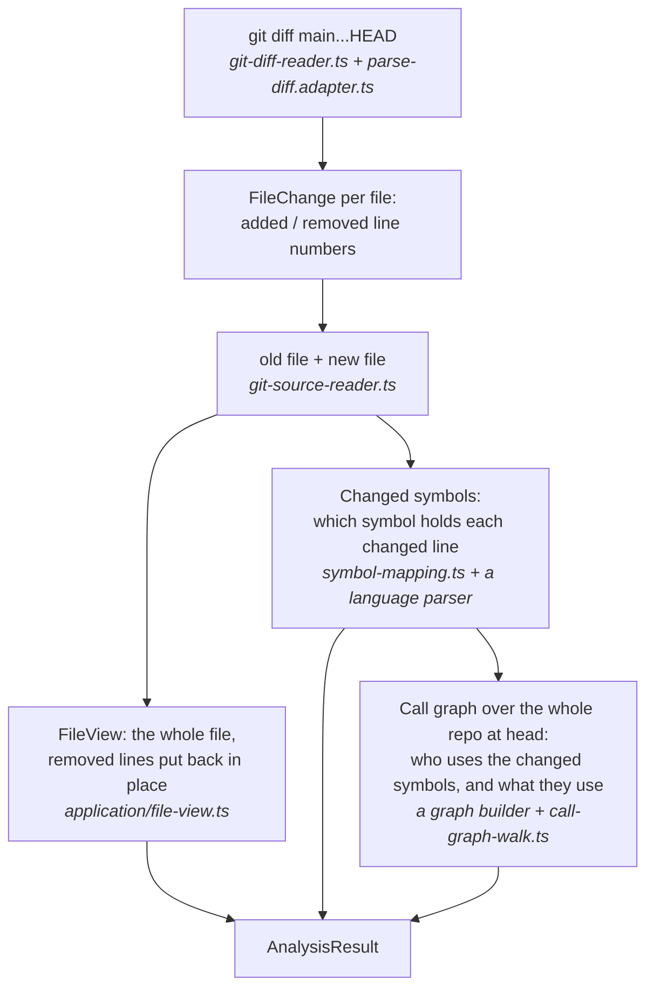
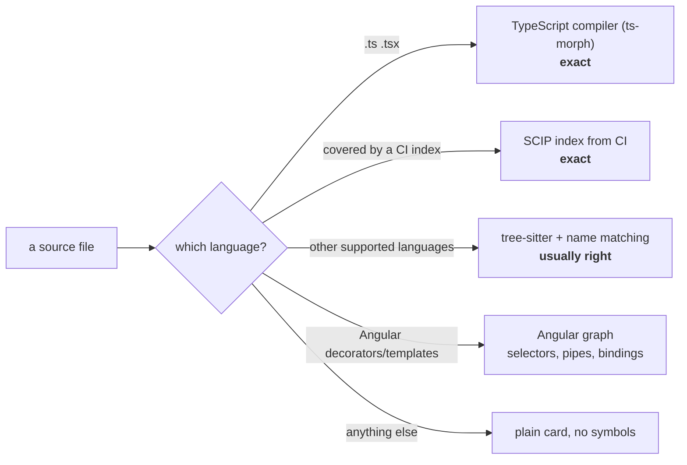
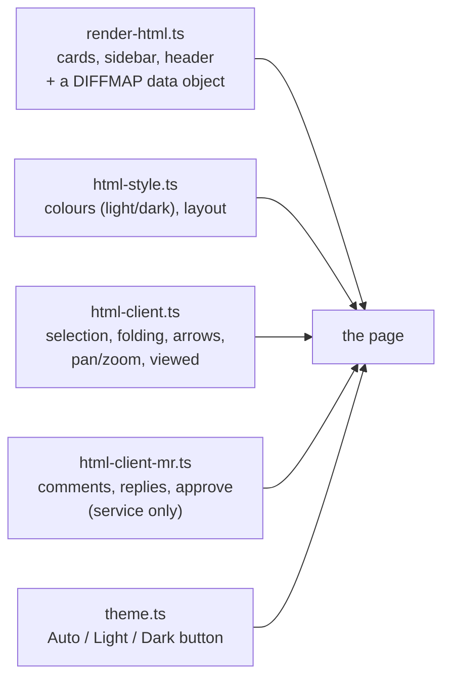
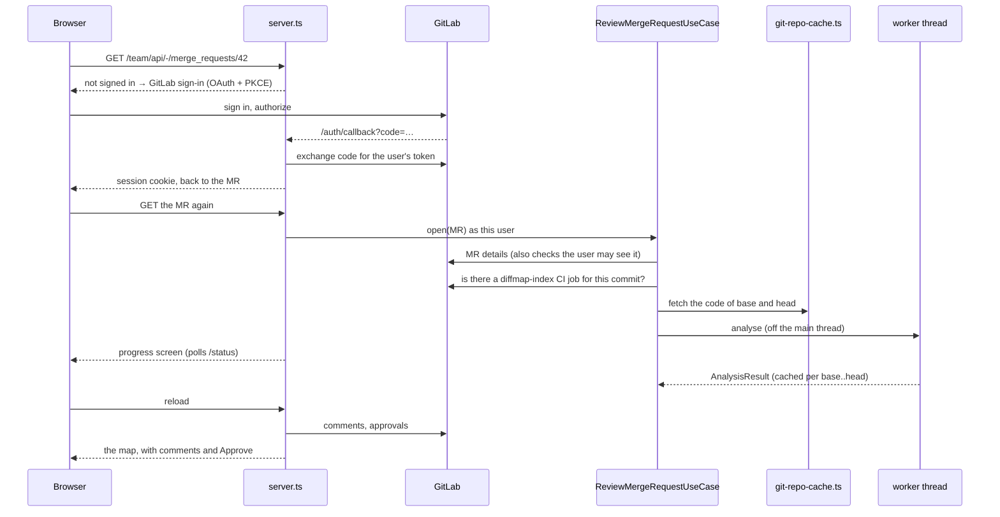

# How diffmap works

This document explains how diffmap is built, for someone new to the code.
Read it top to bottom once; after that, the [cookbook](#where-to-change-what)
at the end tells you which file to open for a given change.

---

## 1. The whole thing in one picture

diffmap is a **find-references tool for code review**. Everything it does is
these four steps. The command line and the GitLab service are just two
different front doors to the same analysis.

---

## 2. Words used everywhere

| Word | Meaning | Defined in |
|---|---|---|
| **base / head** | The two versions compared. *base* = before (e.g. `main`), *head* = after (your branch). | |
| **diff line** | One line of the change: added (`add`), removed (`del`) or unchanged (`ctx`), with its line number in the old and/or new file. | [domain/symbol.ts](src/domain/symbol.ts) |
| **file view** | A whole file as one list of lines: every line of the new file, with removed lines put back where they were. This is what a card on the map shows. | [domain/file-view.ts](src/domain/file-view.ts) |
| **symbol** | A named piece of code: function, method, class, interface, enum, arrow function, Angular template… Its id is `file#Name`, e.g. `src/auth.ts#AuthService.login`. | [domain/symbol.ts](src/domain/symbol.ts) |
| **changed symbol** | A symbol that contains changed lines, with a status: `added`, `removed` or `modified`. | |
| **node** | A symbol on the map: either changed, or an unchanged neighbour (a caller or callee). | [domain/graph.ts](src/domain/graph.ts) |
| **edge** | A link between two nodes: `calls` (uses), `implements`, or `calls-removed` (still calls code the change deletes). Each edge lists its **sites**: the exact lines where the use is written. | [domain/graph.ts](src/domain/graph.ts) |
| **analysis result** | Everything above for one base..head: changed symbols, file views, nodes, edges, branch names. The JSON output of the CLI. | [domain/analysis-result.ts](src/domain/analysis-result.ts) |
| **port** | An interface the core needs ("give me the diff", "find symbols in this file"). The core only knows ports, never git or GitLab directly. | [application/ports/](src/application/ports/) |
| **adapter** | A real implementation of a port (git, ts-morph, tree-sitter, GitLab…). | [infrastructure/](src/infrastructure/) |

---

## 3. The layers

The code is split into four layers. **An inner layer never imports an outer one.**
That is what lets the same analysis serve the CLI and the service, and lets a
new language plug in without touching anything else.

| Folder | What lives there |
|---|---|
| [src/domain/](src/domain/) | Data shapes only: `ChangedSymbol`, `FileView`, `GraphNode`, `GraphEdge`, `AnalysisResult`. |
| [src/application/](src/application/) | The two use cases ([analyze-range](src/application/use-cases/analyze-range.ts), [review-merge-request](src/application/use-cases/review-merge-request.ts)), the ports, and logic every language shares: [symbol-mapping](src/application/symbol-mapping.ts) (changed lines → symbols), [call-graph-walk](src/application/call-graph-walk.ts) (keep the neighbourhood of the change), [file-view](src/application/file-view.ts). |
| [src/infrastructure/](src/infrastructure/) | Everything that touches the outside world or a specific language. |
| [src/interfaces/](src/interfaces/) | [cli/](src/interfaces/cli/), [html/](src/interfaces/html/) (the page), [server/](src/interfaces/server/) (the web service). |
| [src/index.ts](src/index.ts), [src/server.ts](src/server.ts) | The two programs: they create the adapters and plug them into the use cases ("wiring"). |

---

## 4. Journey 1: `diffmap main --format html`

1. **[cli/index.ts](src/interfaces/cli/index.ts)** reads the options. With `--scip`, it reads the index files.
2. **[language-support.ts](src/infrastructure/language-support.ts)** loads every language once and returns three lists: *parsers* (find symbols), *graphs* (find references), *highlighters* (colours). With an index, `withIndex()` puts the SCIP graph in front.
3. **[AnalyzeRangeUseCase](src/application/use-cases/analyze-range.ts)** does the analysis (next section) and returns an `AnalysisResult`.
4. **[render-html.ts](src/interfaces/html/render-html.ts)** turns it into one HTML file that needs no server.

---

## 5. How the analysis works

Inside [AnalyzeRangeUseCase.execute](src/application/use-cases/analyze-range.ts), for a change from `main` to your branch:

**Finding changed symbols** ([symbol-mapping.ts](src/application/symbol-mapping.ts)):
the language lists all symbols of the old and the new file. Each changed line
belongs to the **smallest** symbol around it, so a change in a method marks the
method, not the whole class. The status comes from whether the symbol exists in
the whole old file and the whole new file: in both = `modified`, only new =
`added`, only old = `removed`.

**Finding references**: a graph builder reads every file of its language in the
repo at head and records every use (`A calls B on line 42`). Then
[walkNeighbourhood](src/application/call-graph-walk.ts) keeps only what matters
for this change: the changed symbols, `--depth` hops of callers and callees, and
every call into removed code. Unchanged neighbours carry their **whole source**,
so the page can show a caller in full even though its file did not change.

---

## 6. Languages: three ways to find references

| Engine | Folder | How it finds references |
|---|---|---|
| **TypeScript** | [parsers/typescript/](src/infrastructure/parsers/typescript/) | Loads the whole repo into the TypeScript type checker and asks it what each call points to. Exact. |
| **tree-sitter** | [parsers/tree-sitter/](src/infrastructure/parsers/tree-sitter/) | Parses 13 languages. [languages.ts](src/infrastructure/parsers/tree-sitter/languages.ts) says, per language, which syntax nodes are definitions and which are calls. A call to `update()` is matched **by name**, narrowed to what the caller can reach ([tree-sitter-call-graph.ts](src/infrastructure/parsers/tree-sitter/tree-sitter-call-graph.ts), [visibility.ts](src/infrastructure/parsers/tree-sitter/visibility.ts)): `self.x()` → same class; `Svc.x()` or a typed variable → that class; else same file, then imported files or the same folder; else only if the name is unique. |
| **SCIP index** | [scip/](src/infrastructure/scip/) | Reads an index made in CI by the language's own compiler (scip-typescript, scip-java, scip-clang). Exact references and "implements" links for the files it covers; other files fall back to the engines above. [scip-index.ts](src/infrastructure/scip/scip-index.ts) is a small built-in reader for the format. |
| **Angular** | [parsers/angular/](src/infrastructure/parsers/angular/) | Reads `@Component`, `@Directive`, `@Pipe` and links templates to what they use: `<app-x>` → component, `[appY]` → directive, `\| pipe` → `transform()`, `(click)="save()"` → method. Runs next to the others. |

The header of the page says whether the calls for this change are **exact** or
**matched by name** (`exactness` in the result; each graph builder answers `isExact(file)`).

---

## 7. The page

[render-html.ts](src/interfaces/html/render-html.ts) builds the HTML on the
server side (or in the CLI). The browser then only adds behaviour.

- **Cards (left column):** one per changed file, with old and new line numbers.
  Far unchanged lines are folded; files over 500 lines (HTML over 300) start collapsed.
- **Callers outside the change (right column):** pre-rendered but hidden; shown
  for the selected symbol only. Each caller is shown whole.
- **The `DIFFMAP` object** in the page holds, per changed symbol, its before/after
  lines and every place it is used, with the id of the row to draw an arrow to.
- **[html-client.ts](src/interfaces/html/html-client.ts)** stacks the cards from
  their measured heights, draws the arrows as SVG, handles selection, folding,
  pan/zoom and the "viewed" ticks.
- **[html-client-mr.ts](src/interfaces/html/html-client-mr.ts)** is added only on
  the service: comment threads under their lines, the comment box, Approve.

---

## 8. Journey 2: opening a merge request in the service

| Part | File | What it does |
|---|---|---|
| Settings | [server/config.ts](src/interfaces/server/config.ts) | Reads `GITLAB_URL`, client id/secret, `PUBLIC_URL`, folders, worker count, index job name. |
| Sign-in | [gitlab/gitlab-oauth.ts](src/infrastructure/gitlab/gitlab-oauth.ts), [server/sessions.ts](src/interfaces/server/sessions.ts) | "Sign in with GitLab" (authorization code + PKCE + one-time state). Sessions and tokens are kept **in memory only**: a restart signs everyone out. Tokens refresh shortly before they expire. |
| GitLab API | [gitlab/gitlab-client.ts](src/infrastructure/gitlab/gitlab-client.ts) | MR details, discussions, new comments, replies, approvals, and finding the CI index, all **as the signed-in user**. |
| Code | [gitlab/git-repo-cache.ts](src/infrastructure/gitlab/git-repo-cache.ts) | One bare git repo per project on the data volume. Fetches only the target branch and GitLab's `refs/merge-requests/<iid>/head`, with the user's token. Reports git's progress. |
| Jobs and cache | [review-merge-request.ts](src/application/use-cases/review-merge-request.ts) | Getting an MR ready runs as a background job with a status the progress screen polls. Results are cached per `project@base..head` (last 20). Without an index, it looks again after a minute in case CI finished. |
| Worker threads | [worker/](src/infrastructure/worker/) | The analysis is heavy, synchronous work; it runs in worker threads (`ANALYSIS_WORKERS`, default 2) so the server keeps answering everyone else. |
| Routes | [server/server.ts](src/interfaces/server/server.ts) | Pages, sign-in, the MR page, and the JSON API used by the page (`/api/<project>/-/merge_requests/<iid>/…`: discussions, notes, approve, unapprove, viewed, status). |
| Pages | [server/pages.ts](src/interfaces/server/pages.ts) | Sign-in, start page, errors, the progress screen. |
| Logs | [server/safe-log.ts](src/interfaces/server/safe-log.ts) | Every log line passes through it: no query strings, sign-in codes or tokens are ever written. |

**Comments:** a click on a line number in a changed file posts a GitLab diff
comment at that line. A line in a file outside the MR (a caller card) can't carry
one in GitLab, so it becomes a general comment that quotes `file:line` and the code.

---

## 9. What is stored where

| Data | Where | Lifetime |
|---|---|---|
| Sessions, GitLab tokens | memory of the server | until sign-out or restart |
| Project code (bare git repos) | `CACHE_DIR` (default `/data/repos`) | kept; only new commits fetched |
| Analyses | memory, last 20 MR versions | until restart |
| "Viewed" ticks on the service | `DATA_DIR/viewed.json`, per GitLab user and MR | kept |
| "Viewed" ticks in a CLI report | the browser (localStorage) | per browser |
| Theme choice | the browser (localStorage `diffmap:theme`) | per browser |

---

## 10. Tests

`npm test` runs everything ([vitest](https://vitest.dev)). Many tests build a small
real git repo on the fly ([tests/fixtures/repo.ts](tests/fixtures/repo.ts)).

| Test file | Covers |
|---|---|
| [typescript.test.ts](tests/typescript.test.ts), [graph.test.ts](tests/graph.test.ts) | TypeScript symbols, statuses, call graph, call sites, branch names |
| [tree-sitter.test.ts](tests/tree-sitter.test.ts), [name-matching.test.ts](tests/name-matching.test.ts) | Other languages, highlighting, the narrowing rules |
| [scip.test.ts](tests/scip.test.ts) | Reading indexes and exact calls (with a tiny index writer in the test) |
| [angular.test.ts](tests/angular.test.ts) | Templates, selectors, pipes, bindings |
| [file-view.test.ts](tests/file-view.test.ts), [highlight.test.ts](tests/highlight.test.ts), [html.test.ts](tests/html.test.ts) | Whole-file views, TypeScript colours, the page |
| [gitlab.test.ts](tests/gitlab.test.ts), [server.test.ts](tests/server.test.ts), [storage.test.ts](tests/storage.test.ts), [safe-log.test.ts](tests/safe-log.test.ts) | GitLab client (fake GitLab), sign-in, comments, approve, progress, viewed, log safety |
| [cli.test.ts](tests/cli.test.ts) | The shape of the JSON output |

The browser scripts are checked by hand in a headless browser; see the commit messages.

---

## Where to change what

| I want to… | Open |
|---|---|
| Support a new language (tree-sitter has a grammar) | [parsers/tree-sitter/languages.ts](src/infrastructure/parsers/tree-sitter/languages.ts) + the grammar list in the [Dockerfile](Dockerfile) + a test in [tree-sitter.test.ts](tests/tree-sitter.test.ts) |
| Make name matching smarter | [tree-sitter-call-graph.ts](src/infrastructure/parsers/tree-sitter/tree-sitter-call-graph.ts) (`narrow`), [visibility.ts](src/infrastructure/parsers/tree-sitter/visibility.ts) |
| Recognise a new kind of TypeScript symbol | [parsers/typescript/symbols.ts](src/infrastructure/parsers/typescript/symbols.ts) |
| Change what the page looks like | [html-style.ts](src/interfaces/html/html-style.ts) (colours, layout), [render-html.ts](src/interfaces/html/render-html.ts) (markup) |
| Change how the page behaves | [html-client.ts](src/interfaces/html/html-client.ts), and [html-client-mr.ts](src/interfaces/html/html-client-mr.ts) for comments |
| Add a CLI option | [cli/index.ts](src/interfaces/cli/index.ts) |
| Add a service setting | [server/config.ts](src/interfaces/server/config.ts), [src/server.ts](src/server.ts), `.env.example`, README |
| Call another GitLab API | the port [merge-request.port.ts](src/application/ports/merge-request.port.ts), then [gitlab-client.ts](src/infrastructure/gitlab/gitlab-client.ts) |
| Add a route to the service | [server/server.ts](src/interfaces/server/server.ts) |
| Support another code host (e.g. GitHub) | a new adapter implementing [merge-request.port.ts](src/application/ports/merge-request.port.ts); the analysis and the page stay as they are |
